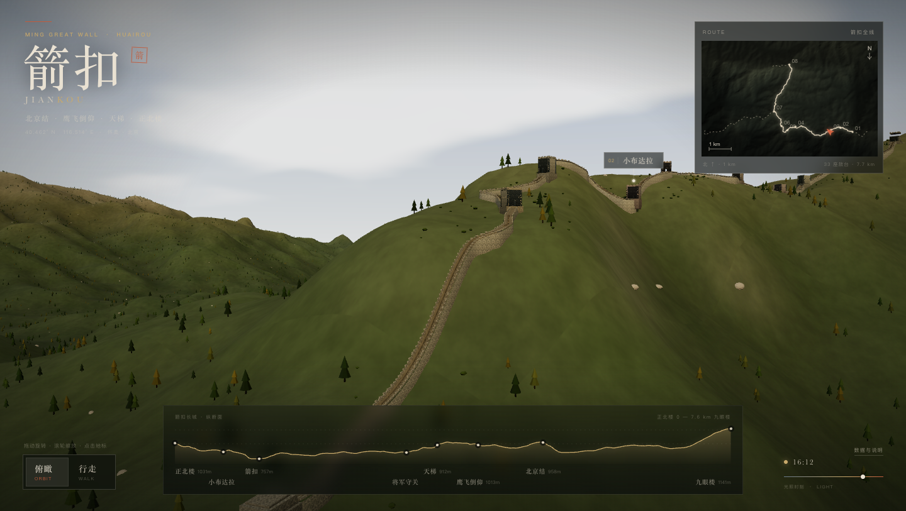
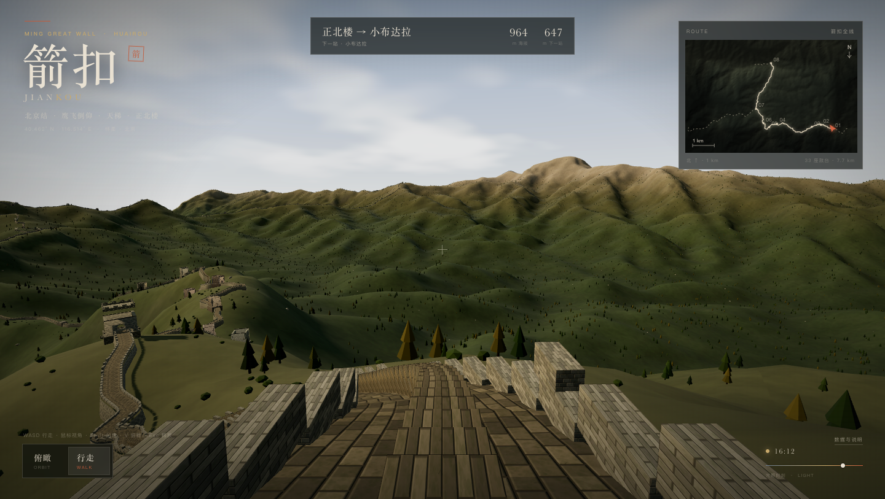
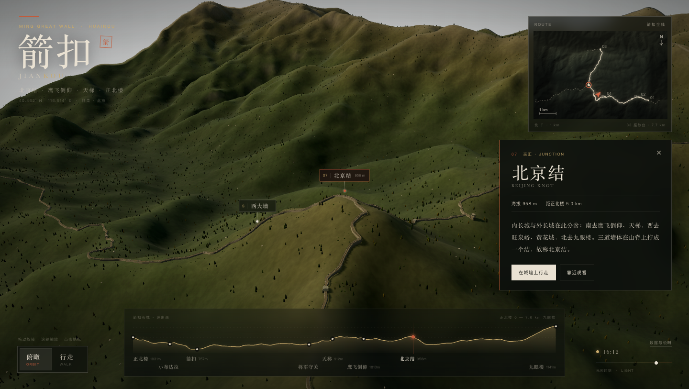

# 箭扣长城 · Jiankou 3D

在浏览器里运行的箭扣长城三维重建。山脊来自真实的 SRTM 高程，墙体走向与敌楼位置来自 OpenStreetMap；边墙、垛口、敌楼、石阶和山林由程序化几何生成。



## 内容

- **主墙约 7.6 km**：从东端的**正北楼**（122 号敌台）经**小布达拉**（128）、**箭扣**、**将军守关**（142）、**天梯**（146）、**鹰飞倒仰**、**北京结**，向北到**九眼楼**。另有**西大墙**、东段、九眼楼西北段三条景观支线。
- **约 50 座敌楼**：位置对应 OSM 敌楼节点，按 122–154 号编号；包含残损基座、无顶、残墙等不同状态，以及北京结的三岔平台与石标。
- **两种视角**：俯瞰轨道相机（可缩放、平移）与第一人称沿墙行走（WASD + 鼠标视角）。
- **九个地标**：在俯瞰中点击 3D 标签、小地图、剖面站点或信息卡即可飞近；行走中可点击小地图上的地标点传送。
- **光照时刻滑杆**：从清晨到黄昏，太阳位置、天空、云层、雾和阴影实时变化。
- **导航界面**：路线小地图、全线高程剖面、地标信息卡、数据说明。
- 无外部图片资产；砖石、铺地、植被均由代码生成。





## 运行

需要 Node **20.19+ / 22.12+**（Vite 7）。推荐 pnpm：

```bash
pnpm install
pnpm dev
```

打开 <http://127.0.0.1:5173>。

```bash
pnpm build      # 类型检查 + 生产构建到 dist/
pnpm preview    # 预览生产构建
```

如果安装时提示 esbuild 的构建脚本被忽略，运行一次 `pnpm approve-builds --all` 即可；本项目使用 esbuild 的预编译平台二进制，通常直接 `pnpm dev` 也能工作。

### URL 参数

| 参数 | 示例 | 作用 |
| --- | --- | --- |
| `mode` | `mode=walk` | 直接进入行走模式 |
| `at` | `at=jiankou` | 定位到某个地标：`zhengbeilou` `xiaobudalagong` `jiankou` `jiangjun` `tianti` `yingfei` `beijingjie` `jiuyanlou` `xidawall` |
| `hour` | `hour=17.2` | 光照时刻（6.2–18.6） |
| `quality` | `quality=low` | 低配设备使用低分辨率地形网格 |
| `hint` | `hint=0` | 隐藏第一人称的“点击进入”提示（适合截图） |
| `debug` | `debug=1` | 暴露 `window.__jiankou` 与 `window.__app` 供调试 |

例如：`http://127.0.0.1:5173/?mode=walk&at=yingfei&hour=16.4`

## 操作

**俯瞰**

- 拖动旋转，滚轮缩放，右键拖动平移。
- 点击 3D 地标标签、右侧地图上的点、底部剖面上的站点，均可飞近。
- `R` 回到默认机位；`V` 切换行走。

**行走**

- 点击画面进入鼠标锁定；`W/S` 前进后退，`A/D` 横移，`Shift` 加速。
- 鼠标控制视角；`Esc` 释放鼠标；`V` 返回俯瞰。
- 在城墙上会自动跟随墙顶高度；进入敌楼时自动收拢到门洞中线。
- 底部剖面在行走时收起，顶部状态条显示当前区段、海拔与下一站距离。

## 数据与构建方法

1. **地形**：AWS Open Data 的 Terrarium 高程瓦片（Mapzen，SRTM 派生），z14，重采样为 1024×813（约 10 m/像素），保留真实山脊走势。`scripts/build_terrain.py` 下载、拼接并输出 `public/data/terrain.png`（Terrarium 编码）与 `terrain.json`。
2. **墙体走向**：OpenStreetMap 的 `barrier=city_wall` / `historic=citywalls` 路径，按 正北楼 → 箭口 → 将军守关 → 天梯 → 鹰飞 → 北京结 → 九眼楼 串联；`scripts/build_wall.py` 处理分叉、用 Douglas–Peucker 简化并投影敌楼。
3. **场景生成**：运行时把经纬度投影到局部米制坐标；沿墙重采样（2 m），墙顶高程取山脊局部最高点的平滑值并抬高约 2.7 m；生成 4.3 m 宽的砖铺马道、两侧垛口、坡度大于约 15° 处的石阶。
4. **敌楼**：按 OSM 敌楼节点投影到墙上的弧长位置；用带拱门/箭窗的挤出面片生成空腔楼体，按编号与残损类型赋予不同高度、屋顶和瓦砾。
5. **植被**：按坡向、海拔和噪声分布程序化针叶林、灌木与石灰岩碎石，避让墙体走廊。
6. **光照**：太阳方位/高度按小时近似计算，实时更新方向光、半球光、天空渐变、程序化云层与阴影。

所有墙体和敌楼都是**解释性重建**，不是测绘成果。地形为 30 m 级 SRTM 的平滑结果，陡崖和碎石细节被弱化；墙体高度、垛口、阶梯、植被为程序化生成。请勿用于实地导航。

### 重新生成数据

```bash
python3 scripts/build_terrain.py   # 需要 numpy + Pillow，会联网下载高程瓦片
python3 scripts/build_wall.py      # 读取 scripts/raw/ 的 OSM 原始 JSON
```

`scripts/raw/osm-walls.json` 与 `osm-named.json` 是 2026-10 下载的 OSM 提取，已随仓库保存；`scripts/raw/terrain-tiles/` 是下载缓存（已忽略）。

## 目录

```text
src/
  main.ts          场景装配、模式切换、URL 参数
  terrain.ts       地形网格与顶点着色
  route.ts         墙体中心线、墙顶高程、弧长投影
  wall.ts          墙身、垛口、石阶、敌楼、北京结平台
  vegetation.ts    树、灌木、碎石
  textures.ts      程序化砖石/铺地/地形纹理与法线
  sky.ts           天空、云、太阳与雾
  overview.ts      OrbitControls + 镜头飞行
  walk.ts          第一人称、沿墙约束、鼠标锁定
  hud.ts           信息卡、剖面、行走状态、加载与说明
  minimap.ts       路线小地图
  labels.ts        3D 地标标签
  data.ts          地形解码与经纬度投影
scripts/           数据构建脚本与 OSM 原始数据
public/data/       烘焙后的地形与墙体数据
docs/              应用截图
```

## 数据来源

- 墙体走向、敌楼坐标：[OpenStreetMap](https://www.openstreetmap.org/)，© OpenStreetMap contributors，ODbL 1.0。
- 地形高程：[AWS Open Data Terrain Tiles](https://registry.opendata.aws/terrain-tiles/)（Mapzen / SRTM 派生），公有领域。
- 地标坐标与海拔、景点顺序：[Beijing Walking — Jiankou Great Wall and Xizhazi village](http://www.beijingwalking.com/jiankou-great-wall/)。
- 敌楼编号与段落考据：[《走了十四次的箭扣长城》系列行记](https://blog.sina.com.cn/s/blog_41370d690102x7m7.html)（将军守关=142 号、小布达拉=128 号、天梯顶=146 号等）。

## 许可

代码以 MIT 许可发布（见 `LICENSE`）。`public/data/wall.json` 及其由 OSM 数据派生的部分是 ODbL 1.0；地形数据为公有领域。应用内的“数据与说明”面板也列出了来源。
